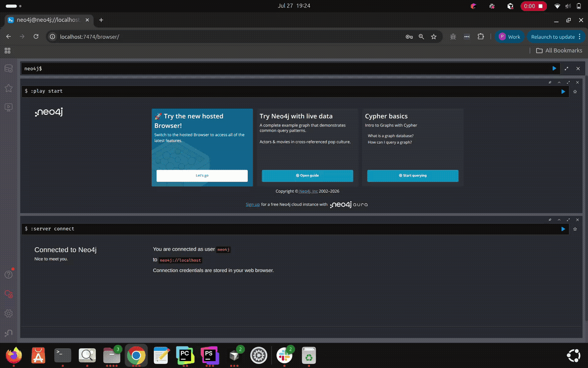
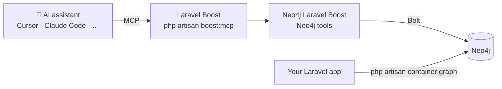
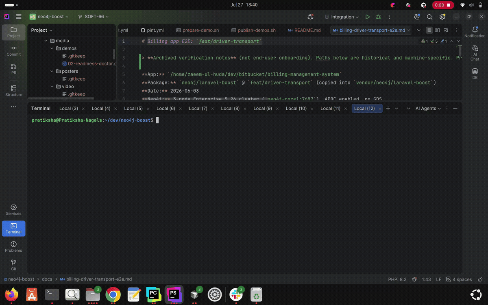
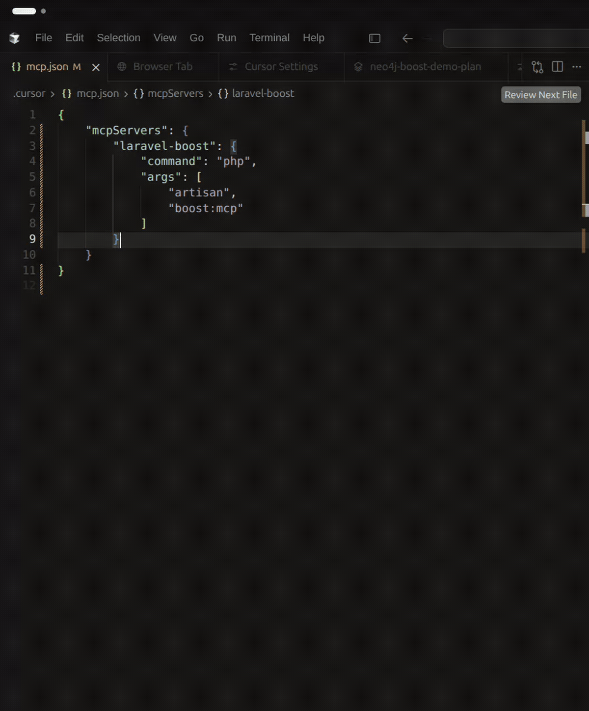
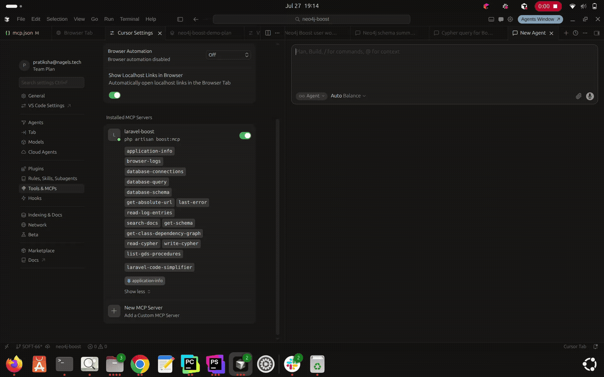
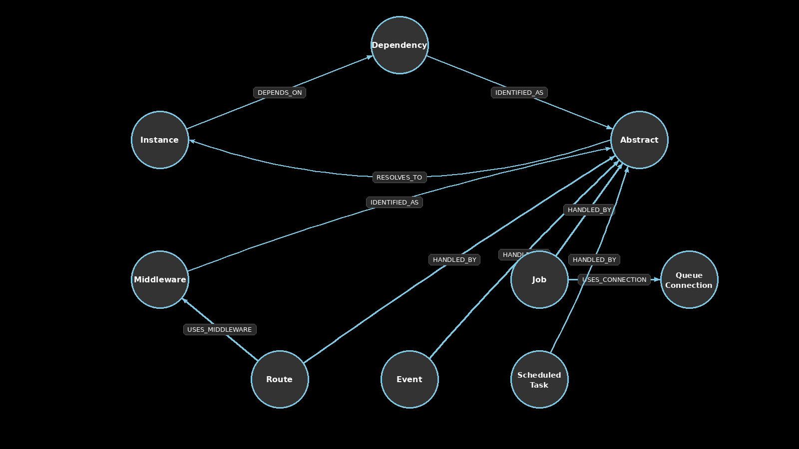
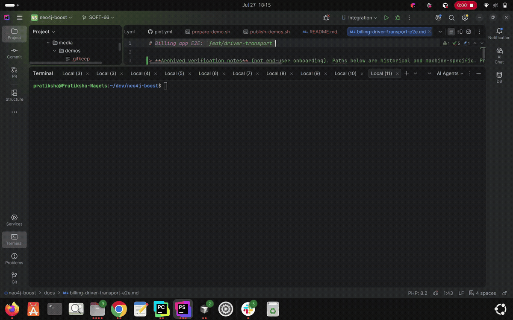

<div align="center">

# Neo4j Laravel Boost

### Give your AI assistant x-ray vision into your Laravel app.

Your assistant can read your files. Now it can also query your live Neo4j database<br>
and **see how your whole Laravel app is wired together**: routes, jobs, events, policies, and every dependency behind them.

[](https://packagist.org/packages/neo4j/laravel-boost)
[](https://www.php.net/)
[](https://laravel.com/)
[](https://packagist.org/packages/neo4j/laravel-boost)

[](https://github.com/neo4j-php/neo4j-boost/actions/workflows/phpunit.yml)
[](https://github.com/neo4j-php/neo4j-boost/actions/workflows/phpstan.yml)
[](https://github.com/neo4j-php/neo4j-boost/actions/workflows/pint.yml)

**[Quick Start](#5-minute-quick-start)** &nbsp;·&nbsp;
**[Container Graph](#exploring-your-container-dependency-graph)** &nbsp;·&nbsp;
**[Prompts](docs/PROMPTS.md)** &nbsp;·&nbsp;
**[Troubleshooting](docs/TROUBLESHOOTING.md)** &nbsp;·&nbsp;
**[Changelog](CHANGELOG.md)**

<br>



<sub>Your Laravel app, as a graph your AI can walk.</sub>

</div>

<br>

## Ask your app questions it could never answer before

> 💬 **"What does my Neo4j schema look like?"**
> → the assistant runs `get-schema` against your **live** database, not a guess from your code.

> 💬 **"Which classes end up being built when `POST /checkout` is hit?"**
> → it walks route → controller → every dependency in the container graph.

> 💬 **"Which queued jobs use the `redis` connection, and what do they depend on?"**
> → one graph query instead of an afternoon of grepping.

> 💬 **"What breaks if I change `PaymentGateway`?"**
> → `get-class-dependency-graph` shows everything that depends on it, inbound and outbound.

More ready-to-paste prompts: **[docs/PROMPTS.md](docs/PROMPTS.md)**.

<br>

## Why you'll love it

<table>
<tr>
<td width="33%" valign="top">

### 🔌 One MCP entry
Neo4j tools ride on your existing **Laravel Boost** server (`php artisan boost:mcp`). No second server to wire up.

</td>
<td width="33%" valign="top">

### ⚡ Zero binaries
The default **driver** transport talks Bolt straight from PHP. Nothing to download, nothing to keep running.

</td>
<td width="33%" valign="top">

### 🕸️ Your app as a graph
`container:graph` exports routes, middleware, jobs, events, policies, mail, notifications, broadcasting, and container wiring into Neo4j.

</td>
</tr>
<tr>
<td width="33%" valign="top">

### 🧠 Live schema & Cypher
`get-schema`, `read-cypher`, and `write-cypher` work against your real database from any MCP client.

</td>
<td width="33%" valign="top">

### 🩺 Built-in doctor
`neo4j-boost:doctor` checks transport, credentials, and connectivity, then tells you exactly what's wrong.

</td>
<td width="33%" valign="top">

### 🐳 Neo4j in one command
`neo4j-boost:start-neo4j` boots a local Docker Neo4j with APOC ready to go.

</td>
</tr>
</table>

Works with **Cursor**, **Claude Code**, and any other MCP-compatible client.

<br>

## How it works



The assistant gets these tools next to your usual Boost tools:

| Tool | What your assistant can do with it |
| --- | --- |
| `get-schema` | See the labels, relationships, and properties in your live database |
| `read-cypher` | Run read-only Cypher queries |
| `write-cypher` | Create and update data |
| `get-class-dependency-graph` | Trace what a class depends on, and what depends on it |
| `contribute-graph-knowledge` | Record wiring it discovered so the graph gets smarter |
| `list-gds-procedures` | Discover Graph Data Science algorithms (needs the [GDS plugin](#graph-data-science-gds-plugin)) |

Architecture deep dive: [docs/architecture.md](docs/architecture.md) · New to all this? [What is Neo4j Boost?](docs/tutorials/what-is-neo4j-boost.md)

<br>

## Installation

> **Requirements:** PHP 8.2+ and Laravel 12 or 13.

### 1. Install the package

```bash
composer require --dev neo4j/laravel-boost
```

### 2. Add your Neo4j credentials

The default **driver transport** runs the Neo4j tools in PHP over Bolt (via `laudis/neo4j-php-client`), so no `neo4j-mcp` binary is needed:

```env
NEO4J_URI=bolt://localhost:7687
NEO4J_USERNAME=neo4j
NEO4J_PASSWORD=your-password
```

> [!TIP]
> `NEO4J_MCP_TRANSPORT` defaults to `driver`. You can switch to `stdio` (runs the `neo4j-mcp` binary) or `http` (remote MCP server). See [Transport Modes](#transport-modes). For env problems, see [Troubleshooting](docs/TROUBLESHOOTING.md#environment-configuration).

### 3. Run the interactive setup

```bash
php artisan neo4j-boost:setup
```

It checks your connection, can install the `neo4j-mcp` binary, and can start a local Neo4j in Docker.



### 4. No Neo4j yet? Start one

```bash
php artisan neo4j-boost:start-neo4j
```

This starts Neo4j in Docker on `bolt://localhost:7687` and `http://localhost:7474`, with the APOC plugins the schema tools need. If it doesn't come up, see [Docker setup troubleshooting](docs/TROUBLESHOOTING.md#docker-setup).

<br>

## 5-minute Quick Start

Connect your MCP client and you're done. In every client, the server entry is the same:

```json
"mcpServers": {
  "laravel-boost": {
    "command": "php",
    "args": ["artisan", "boost:mcp"],
    "env": {
      "APP_ENV": "local"
    }
  }
}
```

### Cursor

Add the entry above to `.cursor/mcp.json` in your project root, or let the package write it for you:

```bash
php artisan neo4j-boost:cursor-config
```

Open your **Laravel application folder** as the workspace, reload MCP settings, and enable the server. `get-schema`, `read-cypher`, and `write-cypher` appear next to your Boost tools.

<table>
<tr>
<td width="50%"><br><sub><b>Connect the tools</b></sub></td>
<td width="50%"><br><sub><b>Ask for the schema</b></sub></td>
</tr>
<tr>
<td width="50%"><br><sub><b>Read with Cypher</b></sub></td>
<td width="50%"><br><sub><b>Write with Cypher</b></sub></td>
</tr>
</table>

### Claude Code

Add the entry to `claude_code_config.json` (or run `claude mcp add` with the same definition). Open your Laravel application folder as the workspace so `artisan` is reachable.

Now ask: **"What does my Neo4j schema look like?"** Your assistant should answer using `get-schema` against your live database.

> [!NOTE]
> Wrong workspace, missing `APP_ENV=local`, or HTTP `/mcp` 404s? See [MCP configuration troubleshooting](docs/TROUBLESHOOTING.md#mcp-configuration).

<br>

## Exploring Your Container Dependency Graph

This is the superpower. One command exports how your Laravel app is **actually wired at runtime** into Neo4j:

```bash
php artisan container:graph                 # export
php artisan container:graph --dry-run       # extract only, write nothing
php artisan container:graph --print-cypher  # show what gets written
```



What ends up in the graph:

```text
(:Route)-[:HANDLED_BY]->(:Abstract)-[:RESOLVES_TO]->(:Instance)
  -[:DEPENDS_ON]->(:Dependency)-[:IDENTIFIED_AS]->(:Abstract)
(:Route)-[:USES_MIDDLEWARE {order,parameters}]->(:Middleware)-[:IDENTIFIED_AS]->(:Abstract)
(:Event)-[:HANDLED_BY]->(:Abstract)
(:Job)-[:HANDLED_BY]->(:Abstract)
(:Job)-[:USES_CONNECTION]->(:QueueConnection)
(:ScheduledTask)-[:HANDLED_BY]->(:Abstract)
(:AuthGuard)-[:USES_PROVIDER]->(:AuthProvider)
(:AuthProvider)-[:USES_MODEL]->(:Abstract)
(:PasswordBroker)-[:USES_PROVIDER]->(:AuthProvider)
(:Policy)-[:HANDLED_BY]->(:Abstract)
(:Policy)-[:FOR_MODEL]->(:Abstract)
(:GateAbility)-[:HANDLED_BY]->(:Abstract)
(:Notification)-[:HANDLED_BY]->(:Abstract)
(:Notification)-[:USES_CHANNEL]->(:NotificationChannel)
(:Mailable)-[:HANDLED_BY]->(:Abstract)
(:Mailable)-[:USES_MAILER]->(:Mailer)
(:Mailable)-[:USES_CONNECTION]->(:QueueConnection)
(:BroadcastChannel)-[:HANDLED_BY]->(:Abstract)
(:ArtisanCommand)-[:HANDLED_BY]->(:Abstract)
```

`:Abstract` is the container lookup key (the same idea as `make($abstract)`), with a `kind` property (`Class` / `Interface` / `AbstractType`). Bindings use `BINDS_TO` between abstracts.

Then ask your assistant, or call **`get-class-dependency-graph`** directly:

```json
{ "class": "App\\Services\\FooService", "direction": "outbound", "depth": 4 }
```


<details>
<summary><b>🔍 Ready-made Neo4j Browser queries</b> (routes, jobs, scheduled tasks, auth, policies, gates, notifications, mail, broadcasting, Artisan commands)</summary>

<br>

**Routes and their middleware**

```cypher
MATCH path = (r:Route)-[:USES_MIDDLEWARE]->(m:Middleware)-[:IDENTIFIED_AS]->(a:Abstract)
RETURN path
LIMIT 50
```

**Jobs, their queue connection, and dependencies**

```cypher
MATCH (j:Job)-[:HANDLED_BY]->(:Abstract)-[:RESOLVES_TO]->(root:Instance)
OPTIONAL MATCH conn = (j)-[:USES_CONNECTION]->(:QueueConnection)
OPTIONAL MATCH path = (root)-[:DEPENDS_ON|IDENTIFIED_AS|RESOLVES_TO*0..8]->(n)
RETURN j, root, conn, path
LIMIT 50
```

**Scheduled tasks**

```cypher
MATCH (t:ScheduledTask)-[:HANDLED_BY]->(:Abstract)-[:RESOLVES_TO]->(root:Instance)
OPTIONAL MATCH path = (root)-[:DEPENDS_ON|IDENTIFIED_AS|RESOLVES_TO*0..8]->(n)
RETURN t, root, path
LIMIT 50
```

**Auth guards, providers, and models**

```cypher
MATCH (g:AuthGuard)-[:USES_PROVIDER]->(p:AuthProvider)
OPTIONAL MATCH model = (p)-[:USES_MODEL]->(:Abstract)-[:RESOLVES_TO]->(root:Instance)
OPTIONAL MATCH path = (root)-[:DEPENDS_ON|IDENTIFIED_AS|RESOLVES_TO*0..8]->(n)
RETURN g, p, root, model, path
LIMIT 50
```

**Policies**

```cypher
MATCH (p:Policy)-[:HANDLED_BY]->(:Abstract)-[:RESOLVES_TO]->(root:Instance)
OPTIONAL MATCH model = (p)-[:FOR_MODEL]->(:Abstract)
OPTIONAL MATCH path = (root)-[:DEPENDS_ON|IDENTIFIED_AS|RESOLVES_TO*0..8]->(n)
RETURN p, root, model, path
LIMIT 50
```

**Gate abilities**

```cypher
MATCH (a:GateAbility)
OPTIONAL MATCH (a)-[:HANDLED_BY]->(:Abstract)-[:RESOLVES_TO]->(root:Instance)
OPTIONAL MATCH path = (root)-[:DEPENDS_ON|IDENTIFIED_AS|RESOLVES_TO*0..8]->(n)
RETURN a, root, path
LIMIT 50
```

**Notifications and channels**

```cypher
MATCH (n:Notification)-[:HANDLED_BY]->(:Abstract)-[:RESOLVES_TO]->(root:Instance)
OPTIONAL MATCH ch = (n)-[:USES_CHANNEL]->(:NotificationChannel)
OPTIONAL MATCH path = (root)-[:DEPENDS_ON|IDENTIFIED_AS|RESOLVES_TO*0..8]->(x)
RETURN n, root, ch, path
LIMIT 50
```

**Mailables, mailers, and queue connections**

```cypher
MATCH (m:Mailable)-[:HANDLED_BY]->(:Abstract)-[:RESOLVES_TO]->(root:Instance)
OPTIONAL MATCH mailer = (m)-[:USES_MAILER]->(:Mailer)
OPTIONAL MATCH conn = (m)-[:USES_CONNECTION]->(:QueueConnection)
OPTIONAL MATCH path = (root)-[:DEPENDS_ON|IDENTIFIED_AS|RESOLVES_TO*0..8]->(n)
RETURN m, root, mailer, conn, path
LIMIT 50
```

**Broadcast channels**

```cypher
MATCH (c:BroadcastChannel)-[:HANDLED_BY]->(:Abstract)-[:RESOLVES_TO]->(root:Instance)
OPTIONAL MATCH path = (root)-[:DEPENDS_ON|IDENTIFIED_AS|RESOLVES_TO*0..8]->(n)
RETURN c, root, path
LIMIT 50
```

**Artisan commands**

```cypher
MATCH (c:ArtisanCommand {source: 'app'})-[:HANDLED_BY]->(:Abstract)-[:RESOLVES_TO]->(root:Instance)
OPTIONAL MATCH path = (root)-[:DEPENDS_ON|IDENTIFIED_AS|RESOLVES_TO*0..8]->(n)
RETURN c, root, path
LIMIT 50
```

</details>

<details>
<summary><b>🕵️ Find hidden dependencies with static scanning</b></summary>

<br>

Runtime reflection can't see service-location calls, facade usage, or direct `new` instantiations. Point the static scanner at your app directories to catch them:

```env
NEO4J_CONTAINER_GRAPH_STATIC_SCAN_PATHS=/absolute/path/to/app/Services,/absolute/path/to/app/Http
```

You can also publish the config and set `container_graph.static_scan_paths`. If unset, no PHP files are scanned and only runtime reflection edges are exported.

</details>

> [!NOTE]
> The export maps every PSR-4 class in the container. On apps with hundreds of services it takes a little while and produces a big graph. That's expected.

<br>

### Available Artisan Commands

| Command | What it does |
| --- | --- |
| `neo4j-boost:setup` | Interactive setup: checks the connection, can configure Docker Neo4j, writes Cursor config |
| `neo4j-boost:start-neo4j` | Starts a local Neo4j Docker instance |
| `neo4j-boost:cursor-config` | Creates or updates `.cursor/mcp.json` |
| `neo4j-boost:install-mcp` | Downloads the official `neo4j-mcp` binary (only needed for STDIO) |
| `neo4j-boost:doctor` | Diagnoses transport, binary, password, and overall readiness |
| `neo4j-boost:test-stdio` | Verbose end-to-end test of the STDIO handshake and tools |
| `container:graph` | Exports routes, middleware, events, jobs, queue connections, scheduled tasks, auth config, policies, gates, notifications, mail, broadcasting, and container wiring into Neo4j (`--dry-run`, `--print-cypher`) |

<br>

## Configuration

### Transport Modes

| Mode | How it connects | When to use it |
| --- | --- | --- |
| **`driver`** (default) | PHP talks to Neo4j over Bolt via `laudis/neo4j-php-client` | Almost always. No binary needed |
| **`stdio`** | Runs the official `neo4j-mcp` binary as a subprocess | You want the official binary. Install it with `php artisan neo4j-boost:install-mcp`, then set `NEO4J_MCP_TRANSPORT=stdio` |
| **`http`** | Calls a remote or containerized MCP server | Set `NEO4J_MCP_TRANSPORT=http` and `NEO4J_MCP_URL=http://localhost:8080/mcp` |

> [!IMPORTANT]
> In HTTP mode this package sends your Neo4j credentials with every request, so **don't** set `NEO4J_USERNAME` or `NEO4J_PASSWORD` on the MCP server container itself.

Run `php artisan config:clear` after editing `.env`. Auth and env mistakes are covered in [Authentication issues](docs/TROUBLESHOOTING.md#authentication-issues) and [Environment configuration](docs/TROUBLESHOOTING.md#environment-configuration).

**Neo4j Aura?** Use the Aura console URI (`neo4j+s://...`) with driver transport. See [Neo4j Aura connectivity](docs/TROUBLESHOOTING.md#neo4j-aura-connectivity).

### Using Docker Compose (HTTP mode)

<details>
<summary><b>🐳 Show the <code>docker-compose.yml</code></b></summary>

<br>

```yaml
services:
  neo4j:
    image: neo4j:5-community
    environment:
      NEO4J_AUTH: neo4j/your-password
      NEO4J_PLUGINS: '["apoc", "graph-data-science"]'
      NEO4J_dbms_security_procedures_unrestricted: 'apoc.*,gds.*'
      NEO4J_dbms_security_procedures_allowlist: 'apoc.*,gds.*'
    ports:
      - "7474:7474"
      - "7687:7687"
    healthcheck:
      test: ["CMD-SHELL", "wget -q -O /dev/null http://localhost:7474 || exit 1"]
      interval: 10s
      timeout: 5s
      retries: 5
      start_period: 15s

  # Official Neo4j MCP server (HTTP mode)
  neo4j-mcp:
    image: mcp/neo4j
    environment:
      NEO4J_URI: bolt://neo4j:7687
      NEO4J_DATABASE: neo4j
      NEO4J_READ_ONLY: "false"
      NEO4J_TELEMETRY: "false"
      NEO4J_TRANSPORT_MODE: http
      NEO4J_MCP_HTTP_HOST: 0.0.0.0
      NEO4J_MCP_HTTP_PORT: "8080"
    ports:
      - "8080:8080"
    depends_on:
      neo4j:
        condition: service_healthy
```

Then point Laravel at it:

```env
NEO4J_MCP_TRANSPORT=http
NEO4J_MCP_URL=http://localhost:8080/mcp
NEO4J_URI=bolt://localhost:7687
NEO4J_USERNAME=neo4j
NEO4J_PASSWORD=your-password
```

Networking, plugin, and port issues: [Docker setup troubleshooting](docs/TROUBLESHOOTING.md#docker-setup).

</details>

### Graph Data Science (GDS) Plugin

`list-gds-procedures` needs the [Graph Data Science](https://neo4j.com/docs/graph-data-science/current/) plugin. Without it, only that tool errors; `get-schema`, `read-cypher`, and `write-cypher` keep working. With Docker, add `NEO4J_PLUGINS: '["apoc", "graph-data-science"]'` and the `NEO4J_dbms_security_procedures_*` variables shown above.

<details>
<summary><b>⚙️ More options</b>: publishing config, running setup after updates, binary platforms</summary>

<br>

**Publish the config** to tweak `neo4j_mcp.transport`, `bolt.uri`, `bolt.username`, `http.url`, and more in `config/neo4j-boost.php`:

```bash
php artisan vendor:publish --tag=neo4j-boost-config
```

**Re-run setup after every `composer update`:**

```json
{
  "scripts": {
    "post-update-cmd": [
      "@php artisan neo4j-boost:setup --no-interaction"
    ]
  }
}
```

**Binary platforms** (`neo4j-boost:install-mcp`): Linux (x86_64, arm64, i386), macOS (x86_64, Apple Silicon), and Windows (x86_64, arm64, i386). Windows uses `.zip` archives (needs `ext-zip`); Linux and macOS use `.tar.gz`. If detection fails, set `NEO4J_MCP_PLATFORM_ASSET` in `.env`.

</details>

<br>

### Common Issues & Troubleshooting

Something off? Start here, especially after any `.env` change (then `php artisan config:clear`):

```bash
php artisan neo4j-boost:doctor
```



| Symptom | Fix |
| --- | --- |
| `Could not open input file: artisan` | Open your Laravel app folder as the workspace, not the package folder. [More](docs/TROUBLESHOOTING.md#mcp-configuration) |
| `There are no commands defined in the "boost" namespace` | Add `"env": { "APP_ENV": "local" }` to your MCP server entry |
| STDIO: `Neo4j password is required` | Set `NEO4J_PASSWORD` in `.env`, then `php artisan config:clear`. [More](docs/TROUBLESHOOTING.md#authentication-issues) |
| APOC / meta errors | Recreate local Neo4j: `php artisan neo4j-boost:start-neo4j --recreate`. [More](docs/TROUBLESHOOTING.md#docker-setup) |
| Docker: can't reach `bolt://localhost:7687` | When Laravel isn't on the host, use the Neo4j service hostname on the container network, then clear config cache |
| HTTP 404 `This server only handles requests to /mcp` | Prefer Laravel Boost (`php artisan boost:mcp`). Connecting directly? Make sure the URL ends in `/mcp` and HTTP transport is on |
| `Unknown function 'gds.version'` | Install the [GDS plugin](#graph-data-science-gds-plugin). Schema and Cypher tools still work without it |
| Aura connection failures | Use the Aura console URI (`neo4j+s://...`) with driver transport. [More](docs/TROUBLESHOOTING.md#neo4j-aura-connectivity) |

The full step-by-step guide (Docker, Aura, MCP, auth, environment, error messages) lives in **[docs/TROUBLESHOOTING.md](docs/TROUBLESHOOTING.md)**.

<br>

## Learn more

| | |
| --- | --- |
| 📖 **[What is Neo4j Boost?](docs/tutorials/what-is-neo4j-boost.md)** | The big picture, in plain words |
| 🚀 **[Getting started](docs/tutorials/getting-started.md)** | Step-by-step first run |
| 🕸️ **[Container graph tutorial](docs/tutorials/container-graph.md)** | Everything `container:graph` can do |
| 💬 **[Prompt library](docs/PROMPTS.md)** | Copy-paste prompts for common workflows |
| 🏗️ **[Architecture](docs/architecture.md)** | Components, MCP, and request flow |
| 🎬 **[Demo media](docs/media/README.md)** | All the GIFs and how they were made |
| 📝 **[Changelog](CHANGELOG.md)** | What changed in each release |

<br>

<div align="center">

**MIT licensed.** Built for Laravel developers who want their AI to actually understand their app.

If it helps you, a ⭐ on GitHub helps others find it.

</div>
